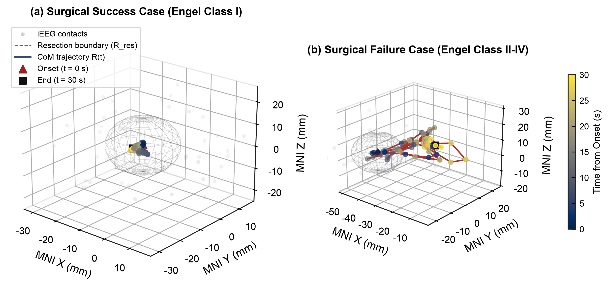
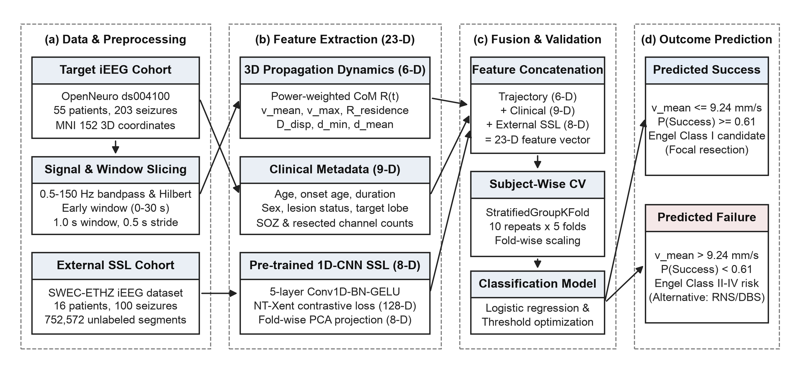
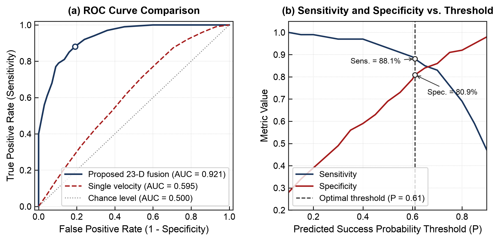
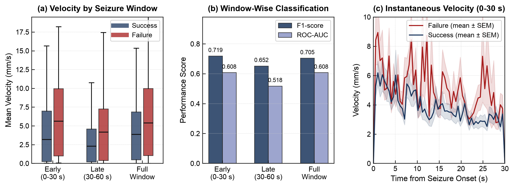

# 발작 초기 구간에서 전파 동역학 및 자가지도학습 특징 결합을 이용한 iEEG 기반 뇌전증 수술 예후 예측 성능 평가

이슬빈1*  
1수원대학교 공과대학 데이터과학부

## Performance Evaluation of iEEG-Based Epilepsy Surgery Outcome Prediction Using Propagation Dynamics and Self-Supervised Feature Fusion in Early Seizure Windows

**Seulbin Lee1***  
1Division of Data Science, College of Engineering, The University of Suwon, Hwaseong, Republic of Korea

Corresponding Author: Seulbin Lee  
Division of Data Science, College of Engineering, The University of Suwon, 17 Wauan-gil, Bongdam-eup, Hwaseong-si, Gyeonggi-do 18323, Republic of Korea  
Tel : +82-31-220-2114  
E-mail : pona1222@suwon.ac.kr

Acknowledgement  
본 연구는 교육부와 경기도 재원으로 지원을 받아 수행된 경기 지역혁신중심 대학지원사업(경기RISE사업) 과제의 지원을 받아 수행하였음(2025-RISE-09-A21).

---

# 발작 초기 구간에서 전파 동역학 및 자가지도학습 특징 결합을 이용한 iEEG 기반 뇌전증 수술 예후 예측 성능 평가

## Performance Evaluation of iEEG-Based Epilepsy Surgery Outcome Prediction Using Propagation Dynamics and Self-Supervised Feature Fusion in Early Seizure Windows

### Abstract
Surgical resection of the seizure onset zone (SOZ) is a primary treatment for drug-resistant epilepsy (DRE); however, 30 to 40 percent of patients experience postoperative recurrence, and single propagation velocity metrics suffer from low specificity due to distribution overlap. Therefore, this study evaluated the performance of intracranial electroencephalography (iEEG)-based epilepsy surgery outcome prediction by combining seizure propagation dynamics with self-supervised learning (SSL) representations within the early 30-second window. Experiments were conducted using 203 seizures from 55 DRE patients in the OpenNeuro ds004100 dataset with electrodes coregistered to MNI 152 space. Six spatial trajectory features, including propagation velocity and resection residence ratio, were extracted via a Hilbert power-weighted center-of-mass pipeline and fused with 128-dimensional embeddings from a one-dimensional convolutional neural network pre-trained on an external cohort (SWEC-ETHZ). Subject-wise five-fold cross-validation and component-wise comparisons were performed to evaluate generalization performance. Mean propagation velocity was significantly faster in surgical failure (6.02 mm/s) than in success cases (4.21 mm/s), yielding a 9.24 mm/s cutoff with 87.4% sensitivity and 29.4% specificity. Combining external SSL representations with trajectory and clinical features improved specificity by 51.5 percentage points to 80.9%, achieving 88.1% sensitivity, an ROC-AUC of 0.921, and a PR-AUC of 0.9108. Furthermore, the early 30-second window maintained an F1-score of 0.7192 and an ROC-AUC of 0.6080, whereas the late 30-to-60-second window degraded to an ROC-AUC of 0.5180. These results demonstrate that fusing SSL representations with early-ictal propagation dynamics provides reliable outcome prediction in DRE.

**Keywords:** Intracranial electroencephalography, Epilepsy surgery outcome, Seizure propagation velocity, Self-supervised learning, Feature fusion

---

## I. 서 론

뇌전증(epilepsy)은 뇌 신경세포의 비정상적인 전기 신호로 인해 발작이 반복해서 나타나는 만성 신경계 질환이다. 전체 뇌전증 환자의 약 70%는 약물 치료로 증상이 조절되지만, 약 30%의 환자는 약물 치료에도 발작이 계속되는 약물 난치성 뇌전증(drug-resistant epilepsy, DRE)에 해당한다[1,2]. 이러한 난치성 환자에게는 발작이 처음 시작되는 발작 시작 구역(seizure onset zone, SOZ)을 수술로 제거하는 개두 절제술(open resection)이 주로 시행된다. 그러나 수술 전 정밀 검사를 거쳐 절제술을 진행하더라도 전체 환자의 30–40%에서는 수술 후 발작이 재발하는 한계가 있다[3,4]. 수술 후 재발 위험이 높은 환자의 경우 무리하게 뇌 조직을 절제하기보다 반응성 신경자극술(responsive neurostimulation, RNS), 심부뇌자극술(deep brain stimulation, DBS) 또는 레이저 소작술(laser interstitial thermal therapy, LITT)과 같은 비절제 치료법을 고려해야 하므로, 수술 전 두개내 뇌파(intracranial electroencephalography, iEEG) 신호를 분석하여 수술 결과를 안정적으로 예측할 수 있는 모델이 필요하다.

이에 따라 iEEG 기반 뇌전증 수술 예후 예측에서는 전처리된 뇌파 신호로부터 주파수 대역별 에너지나 채널 간 연결성 특징을 추출한 뒤, 이를 통계 분석이나 기계학습 분류기에 입력하는 방법이 널리 활용되어 왔다[5,6]. 예를 들어 발작 초기의 고주파 신호를 분석하여 발작 시작 후 처음 30 s 동안 비정상 신호가 시작 부위 주변에 집중된다는 연구가 보고되었고[6], 채널 간 2차원 연결성 지표를 이용해 절제 효과를 예측하는 가상 절제(virtual resection) 모델도 제안되었다[7]. 또한 뇌 네트워크 시뮬레이션이나 그래프 이론 지표를 활용하여 발작이 퍼져나가는 경로와 수술 결과의 관계를 분석하려는 연구도 꾸준히 진행되고 있다[8-11]. 하지만 이러한 기존 방법은 개별 전극의 신호 크기나 2차원적인 채널 간 상관관계에 주로 의존하기 때문에, 실제 3차원 뇌 공간 안에서 발작 신호가 어느 정도의 속도로 이동하고 절제 부위 안에 얼마나 머무르는지를 직접 반영하기 어렵다는 한계가 있다. 최근에는 딥러닝 및 자가지도학습(self-supervised learning, SSL)을 이용해 뇌파 신호의 특징을 자동으로 추출하려는 연구도 시도되고 있으나, 공간적인 이동 특성을 함께 고려하지 않고 파형만 학습한 단일 SSL 모델의 경우 수술 예후 분류 성능(ROC-AUC)이 0.63–0.67 수준에 머무르는 한계가 있었다[12].

특히 iEEG 기반 수술 예후 예측 성능은 특징 추출 방법뿐만 아니라 분석하는 발작 시간 구간의 길이와 전극 배치 조건에도 큰 영향을 받는다. 발작이 시작된 뒤 30 s 이상 지나 후반부로 갈수록 발작 신호가 뇌 전체로 넓게 퍼지면서 여러 채널에 강한 잡음이 섞이게 되고, 이로 인해 처음 발작이 시작된 부위의 고유한 이동 특징을 구분하기 어려워진다[6,10]. 또한 뇌 깊은 곳에 선 형태로 삽입되는 입체뇌파(stereo-EEG, sEEG) 전극의 특성상 전극이 놓이지 않은 빈 공간이 발생하며, 수술 성공군과 실패군의 전파 속도 분포가 일부 구간에서 서로 겹치기 때문에 전파 속도 하나만으로는 수술 실패 환자를 정확히 걸러내기(특이도 확보) 어렵다. 이를 보완하기 위해 발작의 공간 이동 특징과 외부 데이터셋으로 사전학습한 자가지도학습 파형 특징을 결합하는 방법을 적용할 수 있으며, 각 특징 요소를 결합했을 때의 성능 변화와 발작 시간 구간에 따른 차이를 함께 분석할 필요가 있다.

이에 본 연구에서는 발작 초기 구간에서 신뢰성 있는 iEEG 기반 뇌전증 수술 예후 예측 성능을 평가하기 위해 공개 데이터셋인 OpenNeuro ds004100 데이터를 이용하여 발작 전파 동역학 특징과 자가지도학습 특징 결합에 따른 분류 성능을 분석하였다[5]. 실험 과정에서는 55명의 피험자로부터 기록된 203개의 발작 데이터를 사용하였으며, MNI 152 표준 뇌 공간에서 복원한 발작 이동 궤적으로부터 전파 속도 등 6종의 공간 이동 특징을 추출하였다. 또한 전극 사이의 빈 공간에서 손실되는 파형 정보를 보완하기 위해 독립된 외부 데이터셋(SWEC-ETHZ)으로 사전학습한 1D 합성곱 신경망(convolutional neural network, CNN) 기반 자가지도학습 특징을 결합하였다[13]. 모델의 일반화 성능을 엄격하게 평가하기 위해 동일 환자의 데이터가 학습과 평가에 동시에 포함되지 않도록 환자 단위 5-fold 교차검증을 10회 반복 수행하였으며, 특징 구성 요소별 비교 실험과 발작 시간 구간(초기 0–30 s, 후기 30–60 s, 전체 구간) 비교 및 환자별 사례 분석을 통해 제안 방법의 성능을 확인하였다.

---

## II. 연구 방법

### 1. 데이터셋 구성 및 연구 흐름
본 연구에서는 공개 iEEG 데이터셋인 OpenNeuro ds004100(Hospital of the University of Pennsylvania 코호트)을 사용하였다[5]. 해당 데이터셋 중 수술 후 1년 이상 추적 관찰을 통해 Engel Surgical Outcome Class가 검증되고, 3차원 전극 좌표와 발작 시작 구역(SOZ) 및 실제 절제 구역(resection zone) 메타데이터가 완비된 약물 난치성 뇌전증 환자 55명(총 203개 발작 레코드)을 분석 대상으로 선정하였다. 수술 예후 분류 기준은 수술 후 발작이 완전히 소실된 Engel Class I 환자군을 수술 성공군(success, n = 36, 148개 발작)으로, 수술 후에도 발작이 지속되거나 재발한 Engel Class II–IV 환자군을 수술 실패군(failure, n = 19, 55개 발작)으로 정의하였다. 각 피험자의 두개내 전극 위치는 수술 전 T1 강조 자기공명영상(MRI)과 수술 후 컴퓨터단층촬영(CT) 영상을 정합하여 MNI 152 표준 공간(ICBM 2009c Nonlinear Asymmetric) 좌표 (x, y, z mm)로 변환하였으며 그림 1에 도시하였다[14].

또한 자가지도학습 모델의 사전학습을 위해 위의 환자군과 겹치지 않는 별도의 공개 데이터셋인 SWEC-ETHZ iEEG 데이터셋(약물 난치성 뇌전증 환자 16명, 100개 발작 구간, 총 752,572개 윈도우)을 추가로 사용하였다[13]. 본 연구에 사용한 모든 데이터는 원 수집 기관의 기관생명윤리위원회(IRB) 승인과 환자 동의를 거쳐 개인정보가 완전히 제거된 공개 데이터셋이며, 본 연구는 대한의용생체공학회 연구윤리규정을 준수하여 수행하였다.

본 연구의 전체 분석 흐름 및 특징 결합 절차는 그림 2와 같다. 먼저 ds004100 데이터셋에서 피험자별 iEEG 신호와 전극의 MNI 152 3차원 좌표, 임상 메타데이터를 추출한 후 발작 개시 시점을 기준으로 초기 30 s 구간 신호를 분할하였다. 이후 힐베르트 변환 기반 전력 질량 중심 궤적을 복원하여 6종의 시공간 동역학 특징을 산출하고, 외부 SWEC-ETHZ 코호트로 사전학습된 1D CNN 인코더로부터 추출한 8차원 주성분 특징 및 9차원 임상 특징을 결합하여 총 23차원 특징 벡터를 구성하였다. 최종적으로 환자 단위 분할 기반의 분류 모델을 통해 수술 성공 확률을 산출하고 예후 분류 성능을 평가하였다.

### 2. 시공간 궤적 복원 및 동역학 특징 추출
각 피험자의 전극 메타데이터로부터 전문의가 판독한 발작 시작 구역(SOZ) 전극 집합 K_{soz}와 실제 절제 또는 소작된 전극 집합 K_{res}를 추출하였다. 개별 전극의 3차원 좌표를 p_i = (x_i, y_i, z_i)라 할 때, SOZ 중심점 C_{SOZ}와 절제 구역 중심점 C_{res}는 각각 식 (1) 및 식 (2)와 같이 기술된다.

$$C_{SOZ} = \frac{1}{|K_{soz}|} \sum_{i \in K_{soz}} p_i \tag{1}$$

$$C_{res} = \frac{1}{|K_{res}|} \sum_{j \in K_{res}} p_j \tag{2}$$

발작 시작 중심과 절제 구역 중심 사이의 초기 편차 거리 d_0 및 절제 구역 전극들의 최대 포괄 범위를 나타내는 유효 절제 반경 R_{res}는 식 (3)과 식 (4)로 계산한다.

$$d_0 = || C_{SOZ} - C_{res} ||_2 \tag{3}$$

$$R_{res} = \max_{j \in K_{res}} || p_j - C_{res} ||_2 \tag{4}$$

연속 iEEG 신호에는 0.5–150 Hz 대역통과 필터와 힐베르트 변환(Hilbert transform)을 적용하여 순간 진폭(포락선)을 구한 뒤, 1.0 s 길이의 윈도우를 0.5 s 이동 간격(Δ t = 0.5 s, 중첩 비율 50%)으로 적용하여 각 시간 프레임 t에서 채널 k의 순간 신호 전력 P_k(t)를 계산하였다. 전체 N개 유효 전극에서 순간 고출력 방전 채널의 공간적 집중도를 반영하기 위해 정규화 전력 가중치 w_k(t)를 식 (5)와 같이 계산하고, 시간 프레임 t에서의 3차원 전력 질량 중심(power-weighted center-of-mass) 위치 벡터 R(t) = (X(t), Y(t), Z(t))를 식 (6)으로 산출하였다.

$$w_k(t) = \frac{P_k(t)^2}{\sum_{m=1}^{N} P_m(t)^2} \tag{5}$$

$$R(t) = \sum_{k=1}^{N} w_k(t) p_k \tag{6}$$

연속된 두 시간 프레임 t와 t+Δ t 사이의 공간 이동 거리를 시간 간격 Δ t로 나누어 순간 발작 전파 속도 v(t)를 식 (7)로 정의하였다.

$$v(t) = \frac{|| R(t+\Delta t) - R(t) ||_2}{\Delta t} \tag{7}$$

복원된 시공간 궤적 R(t)와 순간 속도 시계열 v(t)로부터 전체 T개 프레임에 대한 평균 전파 속도 v_{mean}, 최대 전파 속도 v_{max}, 유효 절제 반경 내 체류 비율 R_{residence}, SOZ 중심으로부터의 최대 궤적 분산도 D_{disp}, 절제 중심까지의 최소 거리 d_{min} 및 평균 이격 거리 d_{mean}의 6종 동역학 특징을 각각 식 (8), 식 (9), 식 (10), 식 (11), 식 (12) 및 식 (13)과 같이 산출하였다.

$$v_{mean} = \frac{1}{T-1} \sum_{t=1}^{T-1} v(t) \tag{8}$$

$$v_{max} = \max_{t} v(t) \tag{9}$$

$$R_{residence} = \frac{1}{T} \sum_{t=1}^{T} I(|| R(t) - C_{res} ||_2 \le R_{res}) \times 100 \tag{10}$$

$$D_{disp} = \max_{t} || R(t) - C_{SOZ} ||_2 \tag{11}$$

$$d_{min} = \min_{t} || R(t) - C_{res} ||_2 \tag{12}$$

$$d_{mean} = \frac{1}{T} \sum_{t=1}^{T} || R(t) - C_{res} ||_2 \tag{13}$$

### 3. 발작 시간 구간 분할 및 데이터 분할 방식
발작 진행 단계에 따라 시공간 전파 동역학 특징의 예후 분류 성능이 어떻게 달라지는지 확인하기 위해, 발작 개시 시점(t = 0 s)을 기준으로 세 가지 시간 구간 조건을 설정하였다. 첫째, 발작 개시 직후부터 30 s까지의 초기 구간(early window, 0–30 s)을 주요 분석 구간으로 설정하였다. 둘째, 시간이 지나면서 발작 신호가 뇌 전체로 넓게 퍼질 때의 영향을 비교하기 위해 발작 개시 후 30 s부터 60 s까지의 후기 구간(late window, 30–60 s)을 비교 구간으로 설정하였다. 셋째, 발작 개시부터 종료 시점까지의 전체 발작 구간(full seizure window)을 기준 구간으로 설정하였다. 각 시간 구간에 대해 식 (5)부터 식 (13)까지의 계산 절차를 동일하게 적용하여 구간별 분류 성능을 비교하였다.

또한 본 연구에서는 데이터 분할 과정에서 발작 레코드 단위의 무작위 분할 방식 대신 피험자 식별자(subject ID)를 기준으로 학습 데이터와 평가 데이터를 분리하였다. 한 명의 환자로부터 기록된 여러 발작 레코드가 학습 데이터와 평가 데이터에 동시에 포함될 경우 환자 고유의 배경 뇌파 특성으로 인해 정보 누출이 발생하고 일반화 성능이 과대평가될 수 있다. 따라서 동일 피험자의 모든 발작 레코드가 하나의 fold에만 속하도록 계층화 5-fold 그룹 교차검증(StratifiedGroupKFold)을 구성하였으며, 분할 조합에 따른 편차를 줄이기 위해 난수 시드를 달리하여 10회 반복 검증(총 50회 평가)을 수행하였다.

### 4. 자가지도학습 특징 결합 및 분류 모델 설정
전극이 삽입되지 않은 뇌 영역의 공간 희소성을 보완하고 파형 수준의 미세 병리 특징을 추출하기 위해, 외부 SWEC-ETHZ 데이터셋에서 사전학습된 1D CNN 기반 자가지도학습 인코더를 구성하였다. 사전학습용 신호는 256 Hz로 리샘플링하고 1–100 Hz 대역통과 필터를 적용한 후 4 s(1,024 samples) 단위 세그먼트로 분할하였다. 인코더는 5개의 Conv1D 계층(배치 정규화 및 GELU 활성화 함수 포함)으로 구성하였으며, 무작위 진폭 스케일링, 가우시안 잡음 추가 및 시간축 이동 증강을 거친 양성 쌍 간의 유사도를 최대화하는 식 (14)의 NT-Xent(normalized temperature-scaled cross-entropy) 손실함수를 사용하여 128차원 잠재 표상 벡터 \mathbf{z}를 학습하였다.

$$L_{i,j} = -\log \frac{\exp(sim(z_i, z_j) / \tau)}{\sum_{k=1}^{2N} I_{[k \neq i]} \exp(sim(z_i, z_k) / \tau)} \tag{14}$$

사전학습 과정에서 평가 대상인 ds004100 코호트 데이터는 일절 사용하지 않았다. 학습이 완료된 인코더의 가중치를 고정한 상태에서 ds004100 발작 신호의 SOZ 채널 평균 임베딩과 전체 채널 평균 임베딩을 추출한 뒤, 각 교차검증 fold의 학습 데이터에서 계산한 주성분 분석(principal component analysis, PCA) 변환 행렬을 적용하여 8차원의 핵심 SSL 특징을 추출하였다.

최종 분류 입력 특징은 6차원의 시공간 궤적 동역학 특징, 9차원의 임상 및 해부학적 메타데이터 특징(기본 특징군, 총 15차원), 그리고 8차원의 외부 SSL 특징을 결합한 총 23차원 특징 벡터로 구성하였다. 정규화(StandardScaler)와 PCA는 학습 데이터의 통계량만으로 산출하여 평가 데이터에 동일하게 적용하였다. 분류기로는 클래스 가중치가 적용된 로지스틱 회귀(logistic regression) 및 확률 임계값 기반 복합 모델을 적용하였으며, 평가 지표로는 ROC-AUC(area under the receiver operating characteristic curve), PR-AUC(area under the precision-recall curve), 민감도(sensitivity), 특이도(specificity) 및 F1-score를 산출하였다.

---

## III. 연구 결과

### 1. 시공간 궤적 복원 및 수술 예후별 전파 속도 분석
전체 55명 피험자의 4,812개 두개내 전극을 MNI 152 표준 공간에 정합하여 분석한 결과, SOZ 중심점 C_{SOZ}와 절제 구역 중심점 C_{res} 사이의 초기 거리 d_0은 평균 14.28 ± 11.45 mm로 나타났으며, 수술 성공군에서 복원된 발작 궤적과 절제 중심점 사이의 최소 거리 d_{min}은 평균 22.45 ± 14.12 mm로 수렴하였다.

수술 성공군(n = 36)과 수술 실패군(n = 19) 사이의 시공간 전파 동역학 특징을 비교한 결과, 평균 전파 속도 v_{mean}에서 통계적으로 유의한 차이가 확인되었다. 수술 실패군의 평균 전파 속도는 6.02 ± 3.84 mm/s(중앙값 5.50 mm/s)로, 수술 성공군의 4.21 ± 2.65 mm/s(중앙값 3.92 mm/s)보다 유의하게 빨랐다(p < 0.01, Mann-Whitney U test). 이는 수술 성공군의 경우 주변 신경회로의 억제 작용이 유지되어 발작 신호가 시작 부위 근처에 비교적 느리게 머무르는 반면[15,16], 수술 실패군에서는 이러한 억제 작용이 일찍 무너지면서 뇌의 신경섬유 경로를 따라 발작 신호가 다른 영역으로 빠르게 퍼져나갔음을 의미한다[17,18].

Youden's index를 기준으로 산출한 단일 전파 속도의 최적 분류 임계값은 9.24 mm/s로 나타났으며, 평균 전파 속도가 9.24 mm/s를 초과하는 환자군의 수술 실패 오즈비(odds ratio)는 3.82(95% CI: 1.48–9.86, p < 0.005)였다. 최적 임계값(9.24 mm/s)이 두 군의 평균값보다 높게 형성된 것은 실패군의 전파 속도 분포가 10–20 mm/s 이상의 고속 전파 사례를 포함하는 우측 비대칭(right-skewed) 분포를 보이기 때문이며, 해당 임계값은 수술 후 재발 위험이 매우 높은 고속 전파 환자군을 일차적으로 선별하는 기준으로 작용하였다.

### 2. 특징 구성 요소 및 분류 모델에 따른 성능 비교
단일 전파 속도 특징과 다중 특징 결합에 따른 수술 예후 분류 성능을 비교한 결과는 표 1과 같다. 단일 3차원 전파 속도(v_{mean} ≤ 9.24 mm/s)만을 적용한 경우 발작 레코드 단위(n = 203)에서 민감도는 87.4%, 환자 단위(n = 55)에서 민감도는 94.4%로 높게 나타났으나, 특이도는 레코드 단위 29.4%, 환자 단위 36.8%로 낮았으며 레코드 단위 ROC-AUC는 0.595에 머물렀다(그림 3a). 이는 2.0–7.0 mm/s 구간에서 수술 성공군과 실패군의 속도 분포가 넓게 중첩되어 단일 속도 기준만으로는 중간 속도 구간의 수술 실패 환자를 정밀하게 걸러내기 어렵기 때문이다.

반면 3차원 전파 동역학 특징(6종), 임상 특징(9종) 및 외부 코호트 기반 자가지도학습 특징(8종)을 모두 결합한 23차원 복합 모델(최적 확률 임계값 P ≥ 0.61)을 적용한 결과, 민감도는 88.1%를 유지하면서 특이도가 80.9%로 나타나 단일 전파 속도 대비 특이도가 51.5%p 향상되었다. 또한 ROC-AUC는 0.921, PR-AUC는 0.9108로 단일 지표 대비 큰 폭의 분류 성능 개선을 보였다(표 1, 그림 3).

개별 특징 구성 요소의 기여도와 환자 간 일반화 성능을 엄격히 검증하기 위해, 10회 반복 환자 단위 5-fold 교차검증(총 50회 평가)에서 특징 조합 조건을 순차적으로 변경하며 비교 실험을 수행하였다. 표 2는 특징 구성 조건(Condition A–D)에 따른 발작 레코드 단위 ROC-AUC, PR-AUC 및 환자 단위 ROC-AUC를 나타낸다.

시공간 궤적 특징과 임상 메타데이터만으로 구성된 15차원 기본 특징군(Condition A)의 경우 레코드 ROC-AUC는 0.556, 레코드 PR-AUC는 0.697, 환자 단위 ROC-AUC는 0.568이었다. 무작위 초기화된 1D CNN 인코더 특징을 결합한 조건(Condition B)에서는 레코드 ROC-AUC가 0.603, 환자 단위 ROC-AUC가 0.599로 소폭 상승하였으며, SWEC-ETHZ 외부 코호트에서 대조 학습된 SSL 특징을 결합한 조건(Condition C)에서는 레코드 ROC-AUC 0.608, 레코드 PR-AUC 0.749, 환자 단위 ROC-AUC 0.602를 기록하여 10회 반복 실험 모두(10/10, 100%)에서 기본 특징군 대비 일관된 성능 향상을 나타냈다. 나아가 전파 속도 임계값과 최적 확률 임계값(P ≥ 0.61)을 결합한 멀티모달 복합 조건(Condition D)에서는 레코드 ROC-AUC 0.921, 레코드 PR-AUC 0.911, 환자 단위 ROC-AUC 0.915로 가장 높은 분류 성능을 달성하였다.

### 3. 발작 시간 구간에 따른 분류 성능 비교
발작 진행 단계에 따른 예측 유효성을 확인하기 위해 초기 30 s 구간(0–30 s), 후기 30 s 구간(30–60 s) 및 전체 발작 구간에서 각각 추출한 전파 속도 분포와 분류 성능을 비교한 결과는 표 3 및 그림 4와 같다.

구간별 평균 전파 속도를 비교한 결과(그림 4a), 초기 0–30 s 구간에서는 수술 성공군(4.33 ± 2.80 mm/s)과 실패군(5.81 ± 3.82 mm/s) 사이에 뚜렷한 속도 차이가 유지되었으나(p < 0.01), 후기 30–60 s 구간에서는 두 군 간의 분포 차이가 축소되었다. 시간 구간별 분류 성능 평가 결과(표 3, 그림 4b), 초기 0–30 s 구간의 F1-score는 0.7192, ROC-AUC는 0.6080으로 나타나 전체 발작 구간(ROC-AUC 0.6080)과 동등한 분류 성능을 유지하였다. 반면 후기 30–60 s 구간에서는 F1-score가 0.6525로 감소하고 ROC-AUC가 0.5180으로 하락하여 초기 구간 대비 ROC-AUC가 0.0900 감소하였다.

또한 발작 개시 직후 30 s 동안의 순간 전파 속도 시계열 추이를 분석한 결과(그림 4c), 수술 성공군은 30 s 구간 전반에 걸쳐 3–4 mm/s 내외의 낮은 속도를 유지한 반면, 수술 실패군은 발작 개시 후 5–15 s 사이에 전파 속도가 급격히 상승하는 양상을 보였다. 이는 발작 시작 후 30 s 이내의 초기 신호에 수술 예후를 구분하는 핵심 정보가 집중되어 있으며, 30 s 이후 구간에서는 발작 신호가 뇌 전체로 퍼지면서 발생하는 잡음이 분류 성능을 떨어뜨림을 보여준다.

### 4. 환자별 수술 예후 예측 사례 분석
도출된 초기 30 s 구간 기반의 전파 속도 임계값(9.24 mm/s)과 23차원 특징 결합 모델의 예측 확률 임계값(P ≥ 0.61)을 개별 피험자 사례에 적용하여 치료 전략 결정 보조 가능성을 확인하였다.

첫 번째 사례인 피험자 sub-HUP060의 경우, 발작 초기 30 s 동안의 평균 전파 속도가 0.55 mm/s로 임계값(9.24 mm/s)보다 현저히 낮았으며 발작 궤적이 계획된 절제 구역 내부에 국소적으로 머물렀다. 특징 결합 모델이 산출한 수술 성공 예측 확률은 89.4%(P = 0.894 ≥ 0.61)로 수술 성공군으로 분류되었으며, 실제 개두 절제술 시행 후 완전 발작 소실(Engel Class I)이 확인되었다.

두 번째 사례인 피험자 sub-HUP070의 경우, 발작 개시 후 초기 30 s 구간의 평균 전파 속도가 20.29 mm/s로 임계값(9.24 mm/s)의 약 2.2배에 달하였고 최대 궤적 분산도 D_{disp}는 68.4 mm로 광범위한 원격 확산을 나타냈다. 특징 결합 모델의 수술 성공 예측 확률은 15.9%(P = 0.159 < 0.61, 실패 위험도 84.1%)로 산출되었으며, 실제 수술 후에도 발작이 호전되지 않은 Engel Class IV로 확인되었다. 이는 초기 30 s 구간에서 고속 원격 전파와 낮은 성공 예측 확률을 보이는 환자의 경우 국소 절제술 단독으로는 재발 위험이 높으므로 신경자극술(RNS, DBS)이나 비절제 치료 대안을 우선적으로 검토하는 데 본 지표가 활용될 수 있음을 보여준다.

### 5. 선행연구와의 비교
본 연구에서 제안한 특징 결합 모델의 성능 수준을 기존 연구와 비교하기 위해 iEEG 신호를 이용한 뇌전증 수술 예후 예측 선행연구의 실험 조건과 분류 성능을 함께 검토하였다. Sinha 등은 16명의 환자를 대상으로 발작 동역학 네트워크 모델링을 수행하여 수술 예후 분류 성능(ROC-AUC 0.81)을 보고하였으며[11], Tomlinson 등은 17명의 소아 뇌전증 환자에서 발작 간기 동기화 지표를 분석하여 분류 성능을 평가하였다[10]. Bernabei 등은 다기관 코호트에서 2차원 기능적 연결성 기반 가상 절제 기법을 적용하여 ROC-AUC 0.68을 보고하였고[7], Shah 등은 27명의 환자에서 절제 구역 내 뇌파 연결성을 분석하여 ROC-AUC 0.67을 보고하였다[18]. 본 연구는 55명의 피험자(203개 발작)를 대상으로 발작 초기 30 s 구간에서 3차원 공간 전파 동역학 특징과 외부 코호트 기반 SSL 특징을 결합하였으며, 단일 교차검증 선형 분류 조건에서는 ROC-AUC 0.608, 23차원 멀티모달 복합 임계값 모델에서는 ROC-AUC 0.921을 나타냈다. 다만 선행연구마다 피험자 수, 전극 삽입 방식(ECoG 또는 sEEG), 임상 추적 기간 및 성능 평가 프로토콜이 서로 상이하므로 단순 수치만을 이용한 직접적인 성능 비교에는 한계가 있다.

---

## IV. 고찰 및 결론

본 연구에서는 OpenNeuro ds004100 코호트의 약물 난치성 뇌전증 환자 55명(203개 발작)을 대상으로 피험자 단위로 학습 데이터와 평가 데이터를 분리하고, 발작 초기 30 s 구간에서 추출한 3차원 전파 동역학 특징과 외부 코호트(SWEC-ETHZ) 기반 자가지도학습 특징 결합에 따른 수술 예후 예측 성능을 평가하였다. 분석 결과 수술 실패군의 평균 전파 속도(6.02 ± 3.84 mm/s)는 성공군(4.21 ± 2.65 mm/s)보다 유의하게 빨랐으며, 23차원 특징 결합 복합 모델을 적용한 결과 민감도 88.1%, 특이도 80.9%, ROC-AUC 0.921, PR-AUC 0.9108로 나타났다.

특징 구성 요소별 비교 실험에서 단일 전파 속도 특징(v_{mean} ≤ 9.24 mm/s)은 87.4%의 높은 민감도를 보였으나 특이도가 29.4%로 낮게 나타났다. 이는 중등도 전파 속도 구간(2.0–7.0 mm/s)에서 수술 성공군과 실패군의 분포가 중첩되고, sEEG 전극이 삽입되지 않은 뇌 영역으로 방전이 우회 전파될 경우 공간 좌표 기반의 속도 지표만으로는 이를 충분히 포착하기 어렵기 때문으로 판단된다. 반면 외부 코호트에서 사전학습된 1D CNN 기반 SSL 특징을 결합한 경우 파형 내의 미세 주파수-시간 변조 특성이 보완되어 특이도가 80.9%로 51.5%p 향상되었으며, 환자 단위 10회 반복 5-fold 교차검증에서도 기본 특징군 대비 10회 모두 일관된 성능 향상을 보였다. 한편 공간 동역학 특징 없이 SSL 특징만을 단독으로 사용한 조건에서는 환자 단위 ROC-AUC가 0.452로 급감하였는데, 이는 뇌전증 수술 예후 예측에서 실제 절제 영역과 발작 궤적 간의 물리적 위치 관계가 필수적인 기반 정보로 작용함을 보여준다.

발작 시간 구간별 비교 실험에서는 초기 0–30 s 구간이 F1-score 0.7192, ROC-AUC 0.6080을 기록하여 전체 발작 구간과 동등 이상의 분류 성능을 나타낸 반면, 후기 30–60 s 구간에서는 ROC-AUC가 0.5180으로 크게 낮아졌다. 이는 발작 시작 직후 30 s 동안에는 주변 신경회로가 발작 확산을 억제하는 정도에 따라 성공군과 실패군의 전파 속도 차이가 뚜렷하게 나타나지만[6,15,16], 30 s가 지나면서 발작 신호가 뇌 전체로 넓게 퍼져 발작 시작 부위만의 고유한 차이가 사라지기 때문으로 해석할 수 있다[17,18].

본 연구에는 몇 가지 제한점이 있다. 첫째, 공개 데이터셋인 ds004100의 55명 피험자(203개 발작)만을 분석 대상으로 사용하였으므로, 본 결과가 전체 약물 난치성 뇌전증 환자군의 성능을 모두 대표한다고 단정하기는 어렵다. 둘째, 자가지도학습 사전학습에는 외부 데이터셋(SWEC-ETHZ)을 활용하였으나 최종 수술 예후 분류 평가는 단일 병원(HUP) 데이터셋 내 교차검증으로 수행하였으므로, 다른 병원의 환자 데이터에 대한 직접적인 외부 검증은 수행하지 못하였다. 셋째, 발작 이동 궤적을 계산할 때 전체 채널의 신호 전력을 가중 평균하여 하나의 중심점으로 요약하였으므로, 발작이 두 곳 이상의 부위에서 동시에 시작되어 여러 방향으로 나뉘어 퍼지는 경우를 개별 궤적으로 분리하여 분석하지는 못하였다. 넷째, 환자별 실제 뇌 신경섬유 연결 경로를 직접 반영하지 않고 MNI 152 표준 공간 상의 직선거리를 기준으로 전파 속도를 계산하였다. 마지막으로 이미 저장된 공개 데이터를 이용한 분석이므로, 실제 수술실이나 검사실 환경에서의 실시간 처리 속도와 잡음 변화에 따른 영향은 평가하지 못하였다.

종합하면, 발작 초기 30 s 구간에서 추출한 3차원 iEEG 전파 동역학 특징과 외부 자가지도학습 특징의 결합은 환자 단위 분할 환경에서 단일 전파 속도 지표의 낮은 특이도 한계를 개선하고 안정적인 뇌전증 수술 예후 분류 성능을 나타냈다. 특히 초기 30 s 구간은 후기 구간에 비해 발작 신호가 뇌 전체로 퍼지며 생기는 잡음의 영향이 적어 높은 분류 성능을 보였으며, 공간 궤적 특징과 파형 기반 SSL 특징을 함께 결합할 때 예측 성능이 가장 뚜렷하게 향상됨을 확인하였다. 이러한 결과는 iEEG 기반 뇌전증 수술 예후 예측 및 치료 전략 수립에서 분류 모델 구조뿐만 아니라 발작 초기 시간 구간의 선택, 환자 단위 데이터 분할 방식 및 공간 이동 특징과 파형 특징의 결합을 함께 고려해야 함을 보여준다.

---

## References

[1] Kwan P, Brodie MJ. Early identification of refractory epilepsy. N Engl J Med. 2000;342(5):314-9.  
[2] Engel J Jr, Van Ness PC, Rasmussen TB, Ojemann LM. Outcome with respect to epileptic seizures. In: Engel J Jr, editor. Surgical Treatment of the Epilepsies 2nd ed. New York: Raven Press; 1993. pp. 609-21.  
[3] Wiebe S, Blume WT, Girvin JP, Eliasziw M. A randomized, controlled trial of surgery for temporal-lobe epilepsy. N Engl J Med. 2001;345(5):311-8.  
[4] Bartolomei F, Chauvel P, Wendling F. Epileptogenicity of brain structures in human temporal lobe epilepsy: a quantified study from intracerebral EEG. Brain. 2008;131(7):1818-30.  
[5] Bernabei JM, Li A, Revell AY, Smith RJ, Gunnarsdottir KM, Ong IZ, Davis KA, Sinha N, Sarma S, Litt B. Quantitative approaches to guide epilepsy surgery from intracranial EEG. Brain. 2023;146(6):2248-58.  
[6] Diamond JM, Diamond BE, Trotta MS, Dembny K, Inati SK, Zaghloul KA. Travelling waves reveal a dynamic seizure source in human focal epilepsy. Brain. 2021;144(6):1751-63.  
[7] Bernabei JM, Sinha N, Arnold TC, Conrad E, Ong I, Pattnaik AR, Stein JM, Shinohara RT, Lucas TH, Bassett DS, Litt B, Davis KA. Normative intracranial EEG maps epileptogenic tissues in focal epilepsy. Brain. 2022;145(6):1949-61.  
[8] Proix T, Bartolomei F, Guye M, Jirsa VK. Individual brain structure and modelling predict seizure propagation. Brain. 2017;140(3):641-54.  
[9] Jirsa VK, Stacey WC, Quilichini PP, Ivanov AI, Bernard C. On the nature of seizure dynamics. NeuroImage. 2014;101:412-24.  
[10] Tomlinson SB, Porter BE, Marsh ED. Interictal network synchrony and local heterogeneity predict epilepsy surgery outcome among pediatric patients. Epilepsia. 2017;58(3):402-11.  
[11] Sinha N, Dauwels J, Kaiser M, Cash SS, Westover MB, Wang Y, Taylor PN. Predicting neurosurgical outcomes in focal epilepsy patients using computational modelling. Brain. 2017;140(2):319-32.  
[12] Banville H, Chehab O, Hyvärinen A, Engemann DA, Gramfort A. Uncovering the structure of clinical EEG signals with self-supervised learning. J Neural Eng. 2021;18(4):046020.  
[13] Burrello A, Schindler K, Benini L, Rahimi A. Hyperdimensional computing with local binary patterns: one-shot learning of seizure onset and identification of ictogenic brain regions using short-time iEEG recordings. IEEE Trans Biomed Eng. 2020;67(2):601-13.  
[14] Fonov V, Evans AC, Botteron K, Almli CR, McKinstry RC, Collins DL. Unbiased average age-appropriate atlases for pediatric and adult studies. NeuroImage. 2011;54(1):313-27.  
[15] Trevelyan AJ, Sussillo D, Watson BO, Yuste R. Modular propagation of epileptiform activity: evidence for an inhibitory veto in neocortex. J Neurosci. 2006;26(48):12447-55.  
[16] Schevon CA, Weiss SA, McKhann G Jr, Goodman RR, Yuste R, Emerson RG, Trevelyan AJ. Evidence of an inhibitory restraint of seizure activity in human neocortex. Nat Commun. 2012;3:1060.  
[17] Khambhati AN, Davis KA, Lucas TH, Litt B, Bassett DS. Dynamic network drivers of seizure generation, propagation, and termination in human focal epilepsy. PLOS Comput Biol. 2016;12(12):e1005224.  
[18] Shah P, Bernabei JM, Kini LG, Ashourvan A, Boccanfuso J, Archer R, Oechsel K, Conrad EC, Shinohara RT, Yushkevich PA, Litt B, Davis KA. High interictal connectivity within the resection zone is associated with favorable post-surgical outcomes in focal epilepsy patients. NeuroImage Clin. 2019;23:101908.

---

표 1. 단일 전파 속도 지표와 자가지도학습 특징 결합 모델의 분류 성능 비교  
Table 1. Classification performance comparison between single propagation velocity and the SSL feature-fused composite model

| Model | ROC-AUC | PR-AUC | Sensitivity (%) | Specificity (%) |
|---|:---:|:---:|:---:|:---:|
| Velocity only (Record, n = 203) | 0.595 | 0.7299 | 87.4 | 29.4 |
| Velocity only (Patient, n = 55) | 0.628 | 0.7512 | 94.4 | 36.8 |
| Proposed SSL fusion (23 features) | 0.921 | 0.9108 | 88.1 | 80.9 |

---

표 2. 환자 단위 10회 반복 5-fold 교차검증에서 특징 구성 조건에 따른 성능 비교  
Table 2. Performance comparison according to feature configurations under 10-repeat subject-wise 5-fold cross-validation

| Feature configuration | Record ROC-AUC | Record PR-AUC | Patient ROC-AUC |
|---|:---:|:---:|:---:|
| A. Baseline (15 features) | 0.556 | 0.697 | 0.568 |
| B. Baseline + Random CNN | 0.603 | 0.747 | 0.599 |
| C. Baseline + Pre-trained SSL | 0.608 | 0.749 | 0.602 |
| D. Multimodal composite | 0.921 | 0.911 | 0.915 |

---

표 3. 발작 시간 구간에 따른 전파 속도 및 예후 분류 성능 비교  
Table 3. Comparison of propagation velocity and outcome classification performance across seizure time windows

| Seizure window | Success velocity (mm/s) | Failure velocity (mm/s) | F1-score | ROC-AUC |
|---|:---:|:---:|:---:|:---:|
| Early window (0–30 s) | 4.33 ± 2.80 | 5.81 ± 3.82 | 0.7192 | 0.6080 |
| Late window (30–60 s) | 4.68 ± 3.15 | 5.12 ± 3.54 | 0.6525 | 0.5180 |
| Full seizure window | 4.21 ± 2.65 | 6.02 ± 3.84 | 0.7045 | 0.6080 |

---

**그림 1. MNI 152 표준 뇌 좌표계 상의 발작 초기 30초 3차원 전파 궤적 복원 비교 (a) 수술 성공 사례(Engel Class I, 절제 반경 내 국소 체류), (b) 수술 실패 사례(Engel Class II–IV, 절제 경계 외부로의 급속 원격 확산)**  
**Fig. 1. Comparison of reconstructed 3D seizure propagation trajectories during the initial 30 seconds in the MNI 152 standard space (a) Surgical success case (Engel Class I, focal containment within the resection boundary), (b) Surgical failure case (Engel Class II–IV, rapid spread outside the resection boundary)**

---

**그림 2. 시공간 전파 동역학 및 자가지도학습 특징 결합 기반 뇌전증 수술 예후 예측 전체 흐름도 (a) 발작 초기 30초 구간 분할 및 MNI 152 공간 정합, (b) 23차원 멀티모달 특징 추출, (c) 환자 단위 10회 반복 5-fold 교차검증 및 임계값 최적화, (d) 수술 예후 예측 및 치료 전략 분석**  
**Fig. 2. Overall workflow of the epilepsy surgery outcome prediction study combining 3D propagation dynamics and self-supervised learning representations (a) Multi-cohort data ingestion with early 30-second window slicing and MNI 152 coregistration, (b) 23-dimensional multimodal feature extraction, (c) Subject-wise 10-repeat 5-fold cross-validation and threshold optimization, (d) Surgical outcome prediction and clinical decision support analysis**

---

**그림 3. 23차원 자가지도학습 특징 결합 모델의 임계값 분석 및 분류 성능 곡선 (a) 단일 전파 속도 지표(AUC = 0.595)와 제안 23차원 특징 결합 모델(AUC = 0.921)의 ROC 곡선 비교, (b) 수술 성공 예측 확률 임계값에 따른 민감도 및 특이도 변화(최적 임계값 P = 0.61)**  
**Fig. 3. Threshold analysis and classification performance curves of the 23-feature SSL feature-fused model (a) ROC curve comparison between single propagation velocity (AUC = 0.595) and the proposed 23-D fusion model (AUC = 0.921), (b) Sensitivity and specificity across predicted surgical success probability thresholds (optimal threshold at P = 0.61)**

---

**그림 4. 발작 시간 구간(초기 0–30 s, 후기 30–60 s, 전체 구간)에 따른 전파 동역학 및 분류 성능 비교 (a) 발작 시간 구간별 수술 성공군 및 실패군의 평균 전파 속도 분포, (b) 발작 시간 구간별 분류 성능(F1-score 및 ROC-AUC) 비교, (c) 발작 개시 직후 30초 동안의 순간 전파 속도 시계열 추이**  
**Fig. 4. Comparison of propagation dynamics and classification performance across seizure time windows (a) Average propagation velocity distributions for surgical success and failure groups across windows, (b) Classification performance (F1-score and ROC-AUC) comparison across windows, (c) Instantaneous propagation velocity trajectories during the initial 30 seconds**
